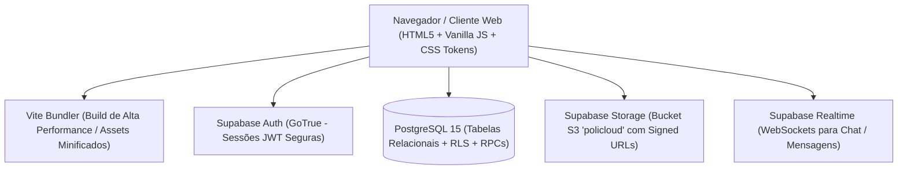

# PoliCloud — Manual Oficial e Documentação do Sistema

**Instituto Politécnico Pascoal Luvualu do Namibe (IPPLN)**  
*Intranet Escolar, Gestão Pedagógica, Nuvem de Materiais e Comunicação Institucional*

---

## 1. Visão Geral e Propósito

O **PoliCloud** é a plataforma integrada de Intranet Escolar e Gestão Académica desenvolvida sob medida para a comunidade do **Instituto Politécnico Pascoal Luvualu do Namibe (IPPLN)**.

A plataforma unifica a experiência digital de estudantes, corpo docente e direção escolar, eliminando a dependência de grupos informais de mensagens (WhatsApp), o uso disperso de pen drives e a burocracia de comunicados em papel. 

### Objetivos Estratégicos:
1. **Centralização Pedagógica:** Disponibilização organizada de sebentas, guiões de laboratório, exercícios e manuais por Curso, Classe, Turma e Disciplina.
2. **Comunicação Confiável e Segura:** Canal oficial para avisos da direção, comunicados pedagógicos e avisos de turma em tempo real.
3. **Controle e Governança:** Administração centralizada de matrículas, perfis, catálogo de cursos, matriz de disciplinas e lotação de professores por turma.
4. **Desempenho e Rigor Estético:** Interface institucional inspirada no *Apple Human Interface Guidelines (HIG)*, ultrarrápida, acessível e 100% responsiva (Desktop, Tablet e Mobile).

---

## 2. Arquitetura e Stack Tecnológica

O PoliCloud adota uma arquitetura orientada a serviços leves no cliente (Multi-Page Application moderna empacotada com Vite) e poder robusto em nuvem via PostgreSQL/Supabase:



### Tecnologias do Sistema:
- **Frontend:** HTML5 semântico, JavaScript moderno (ES Modules), CSS3 puro estruturado com design tokens.
- **Design System:** [css/theme.css](file:///c:/Users/Bright/3D%20Objects/CCNA%20FINAL/policloud/css/theme.css) e [css/style.css](file:///c:/Users/Bright/3D%20Objects/CCNA%20FINAL/policloud/css/style.css) calibrados com escala de 4px/8px, tipografia nativa SF Pro/Inter e suporte a tema claro e escuro (OLED Dark Mode).
- **Compilador / Bundler:** [Vite 6](https://vitejs.dev/) para empacotamento ultrarrápido com separação inteligente de chunks.
- **Backend-as-a-Service (BaaS):** [Supabase](https://supabase.com/) gerenciando autenticação, banco de dados relacional e armazenamento de arquivos.
- **Banco de Dados:** PostgreSQL com políticas de segurança em nível de linha (**Row-Level Security - RLS**) e funções armazenadas (**RPC - Remote Procedure Calls**).
- **Hospedagem & CI/CD:** Vercel integrado diretamente ao repositório GitHub (`main`).

---

## 3. Diretrizes de Design (Apple HIG & Impeccable Architecture)

A interface do PoliCloud foi submetida a uma refatoração estética completa baseada nas regras de engenharia de interface:

1. **Escala Espaçial Rigorosa:** Todos os espaçamentos (paddings, margins, gaps) obedecem estritamente a múltiplos de 4px e 8px (`--space-1: 4px` até `--space-16: 64px`).
2. **Geometria dos Cantos:** Raios de curvatura contidos no intervalo de 4px a 8px (`--radius-control: 6px`, `--radius-card: 8px`, `--radius-modal: 10px`), eliminando a estética genérica de cantos excessivamente arredondados ("pills").
3. **Cores Institucionais:** 
   - Destaque em Modo Claro: **Azul Apple (`#0071E3`)**
   - Destaque em Modo Escuro: **Azul Vibrante (`#2997FF`)**
   - Fundos e Superfícies calibrados para contraste WCAG 2.1 AA.
4. **Sombras de Alta Definição:** Sombras de baixa opacidade combinadas com borda perimetral de 1px (`0 1px 3px rgba(0,0,0,0.04), 0 0 0 1px var(--color-border-subtle)`), evitando manchas escuras ou opacas.
5. **Zero Estilos Inline:** **100% dos atributos `style="..."` foram eliminados** em todas as páginas HTML e scripts dinâmicos, garantindo facilidade de manutenção e máxima performance de renderização.
6. **Acessibilidade e Microinterações:** Pseudo-classes completas (`:hover`, `:active`, `:focus-visible`) em todos os botões, links, seletores e campos de texto.

---

## 4. Matriz de Perfis e Permissões (RBAC)

O sistema implementa Controle de Acesso Baseado em Funções (**Role-Based Access Control**):

| Módulo / Funcionalidade | Aluno | Professor | Administrador |
| :--- | :---: | :---: | :---: |
| **Login e Seleção de Perfil** | ✅ | ✅ | ✅ |
| **Dashboard do Aluno** | ✅ | ❌ | ✅ (Leitura) |
| **Dashboard do Professor** | ❌ | ✅ | ✅ (Leitura) |
| **Painel de Administração Global** | ❌ | ❌ | ✅ (Controle Total) |
| **Gestão de Utilizadores (Criar / Editar / Excluir)** | ❌ | ❌ | ✅ |
| **Gestão de Cursos e Matriz Curricular** | ❌ | ❌ | ✅ |
| **Atribuição de Docentes por Turma** | ❌ | ❌ | ✅ |
| **Nuvem: Download de Materiais da Turma** | ✅ | ✅ | ✅ |
| **Nuvem: Upload para a Própria Turma** | ✅ (Restrito) | ✅ (Qualquer Turma) | ✅ |
| **Mural: Leitura de Avisos** | ✅ (Sua Turma) | ✅ | ✅ |
| **Mural: Publicar Recado e Fixar no Topo** | ❌ | ✅ | ✅ |
| **Calendário: Ver Avaliações da Turma** | ✅ | ✅ | ✅ |
| **Calendário: Agendar Prova / Entrega** | ❌ | ✅ | ✅ |
| **Notícias: Leitura de Comunicados** | ✅ | ✅ | ✅ |
| **Notícias: Publicação Oficial com Foto** | ❌ | ❌ | ✅ |
| **Mensagens & Chat Institucional** | ✅ | ✅ | ✅ |
| **Diagnóstico de Saúde dos Serviços (Health Check)** | ❌ | ❌ | ✅ |
| **Auditoria de Armazenamento por Curso** | ❌ | ❌ | ✅ |

---

## 5. Estrutura de Páginas e Módulos da Aplicação

### 5.1. Página Inicial e Redirecionamento ([index.html](file:///c:/Users/Bright/3D%20Objects/CCNA%20FINAL/policloud/index.html))
- Ponto de entrada padrão da raiz da aplicação.
- Identifica instantaneamente o estado da sessão local do utilizador.
- Redireciona automaticamente para [login.html](file:///c:/Users/Bright/3D%20Objects/CCNA%20FINAL/policloud/login.html) ou para o dashboard específico caso já exista sessão ativa.

---

### 5.2. Autenticação Institucional ([login.html](file:///c:/Users/Bright/3D%20Objects/CCNA%20FINAL/policloud/login.html))
- **Script Controlador:** [js/login.js](file:///c:/Users/Bright/3D%20Objects/CCNA%20FINAL/policloud/js/login.js)
- **Funcionalidades:**
  - Login seguro via email institucional e palavra-passe.
  - Verificação de conta ativa: impede acesso caso a conta tenha sido suspensa (`is_active = false`).
  - Redirecionamento inteligente baseado no papel:
    - Administrador → `/admin.html`
    - Professor → `/dashboard-professor.html`
    - Aluno → `/dashboard-aluno.html`
  - Alternador de tema nativo (Claro / Escuro).
  - Feedback visual animado durante autenticação.

---

### 5.3. Dashboard do Aluno ([dashboard-aluno.html](file:///c:/Users/Bright/3D%20Objects/CCNA%20FINAL/policloud/dashboard-aluno.html))
- **Script Controlador:** [js/dashboard-aluno.js](file:///c:/Users/Bright/3D%20Objects/CCNA%20FINAL/policloud/js/dashboard-aluno.js)
- **Funcionalidades:**
  - Cartão de identificação académica com exibição do Nome, Curso, Classe e Turma.
  - Indicadores de atividade recente e contadores em tempo real.
  - Acesso rápido aos módulos principais: Nuvem de Ficheiros, Mural de Recados, Calendário de Testes e Mensagens.
  - Feed das últimas notícias institucionais e comunicados escolares.
  - Notificações de tarefas pendentes e avaliações agendadas para a sua turma.

---

### 5.4. Dashboard do Professor ([dashboard-professor.html](file:///c:/Users/Bright/3D%20Objects/CCNA%20FINAL/policloud/dashboard-professor.html))
- **Script Controlador:** [js/dashboard-professor.js](file:///c:/Users/Bright/3D%20Objects/CCNA%20FINAL/policloud/js/dashboard-professor.js)
- **Funcionalidades:**
  - Resumo de turmas lecionadas e disciplinas atribuídas ao docente.
  - Ações rápidas: Fazer upload de material, publicar aviso no mural e agendar prova no calendário.
  - Acesso direto ao repositório de ficheiros pedagógicos.
  - Canal de comunicação direta com os estudantes das turmas sob sua orientação.

---

### 5.5. Painel de Administração Geral ([admin.html](file:///c:/Users/Bright/3D%20Objects/CCNA%20FINAL/policloud/admin.html))
- **Script Controlador:** [js/admin.js](file:///c:/Users/Bright/3D%20Objects/CCNA%20FINAL/policloud/js/admin.js)
- **Sub-módulos Integrados:**
  1. **Gestão de Utilizadores:**
     - Criação de contas de Alunos e Professores utilizando cliente isolado (`createIsolatedClient`), permitindo registrar novos utilizadores sem deslogar a sessão do administrador.
     - Edição completa de perfil (nome, curso, classe, turma, redefinição de palavra-passe).
     - Ativação / Desativação imediata de acesso com toggle de 1 clique.
     - Exclusão com confirmação de segurança via modal personalizado.
     - Tabela com filtros de pesquisa e paginação dinâmica.
  2. **Gestão Curricular & Cursos:**
     - Visualização em cartões de cada curso técnico (Informática, Eletricidade, Mecânica, Química, etc.).
     - Cadastro e edição de cursos.
     - Tabela curricular com gestão de disciplinas (código, carga horária, curso associado).
     - Modal de importação de cadeiras existentes para outros cursos.
     - **Atribuição Docente por Turma:** Definição direta de qual professor leciona cada cadeira nas Turmas A, B, C e D.
  3. **Lotação Docente Individualizada:**
     - Modal de atribuições curriculares por professor com resumo de turmas e disciplinas vinculadas.
  4. **Painel de Serviços & Health Check:**
     - Teste de conectividade e latência em tempo real para:
       - API PostgREST do Supabase.
       - Repositório de Arquivos (Storage).
       - Serviço de Autenticação (GoTrue).
       - Banco de Dados PostgreSQL.
     - Exibição de tempo de resposta em milissegundos e carimbo de data/hora do último diagnóstico.
  5. **Auditoria de Armazenamento:**
     - Barra de ocupação total de espaço do storage (utilizado vs. quota).
     - Breakdown dinâmico de consumo de armazenamento por curso.

---

### 5.6. Nuvem de Materiais Pedagógicos ([cloud.html](file:///c:/Users/Bright/3D%20Objects/CCNA%20FINAL/policloud/cloud.html))
- **Script Controlador:** [js/cloud.js](file:///c:/Users/Bright/3D%20Objects/CCNA%20FINAL/policloud/js/cloud.js)
- **Funcionalidades:**
  - Organização inteligente de diretórios: `Curso > Classe > Turma > Disciplina`.
  - Zona de arrastar e soltar (Drag & Drop) com validação de extensão e limite de tamanho (máximo 15 MB).
  - Formatos aceites: PDF, DOCX, DOC, PNG, JPG, JPEG, WEBP.
  - Barra de progresso animada durante o envio de ficheiros.
  - **Versionamento Automático:** Ao enviar um ficheiro com o mesmo nome para uma turma/disciplina existente, o sistema gera automaticamente uma nova versão (`v2`, `v3`) preservando as versões anteriores no histórico.
  - **Download Seguro:** Geração de *Signed URLs* temporárias protegidas por políticas RLS.
  - Filtros instantâneos por Curso, Classe, Turma, Disciplina e pesquisa textual.

---

### 5.7. Mural de Turma & Calendário Académico ([mural.html](file:///c:/Users/Bright/3D%20Objects/CCNA%20FINAL/policloud/mural.html))
- **Script Controlador:** [js/mural.js](file:///c:/Users/Bright/3D%20Objects/CCNA%20FINAL/policloud/js/mural.js)
- **Abas Disponíveis:**
  1. **Mural de Recados:**
     - Visualização isolada para alunos (apenas têm acesso aos avisos da sua própria turma).
     - Seletor dinâmico de turmas para professores e administradores.
     - Avisos de prioridade máxima com destaque de fixação no topo (`pinned`).
     - Modal de publicação com campo de texto e formatação clara.
  2. **Calendário Escolar & Avaliações:**
     - Cronograma ordenado cronologicamente de provas, exames, entregas de projetos e reuniões.
     - Categorização visual por badges coloridos (Exame, Entrega, Reunião, Prática).
     - Agendamento de novos eventos por docentes e administração.

---

### 5.8. Portal de Notícias & Comunicados ([noticias.html](file:///c:/Users/Bright/3D%20Objects/CCNA%20FINAL/policloud/noticias.html))
- **Script Controlador:** [js/noticias.js](file:///c:/Users/Bright/3D%20Objects/CCNA%20FINAL/policloud/js/noticias.js)
- **Funcionalidades:**
  - Portal de notícias oficial para toda a comunidade do IPPLN.
  - Destaque principal expansivo no topo para comunicados fixados pela direção.
  - Filtro por tópicos institucionais:
    - *Todas as Notícias*
    - *Direcção & Secretaria*
    - *Pedagógico & Aulas*
    - *Oficinas & Laboratórios*
    - *Eventos & Ciência*
  - Modal de leitura integral do comunicado com imagem de capa de alta resolução e metadados.
  - Painel de publicação exclusivo para administradores, com upload de imagem de capa, prévia visual e barra de progresso.

---

### 5.9. Mensagens & Chat Escolar ([mensagens.html](file:///c:/Users/Bright/3D%20Objects/CCNA%20FINAL/policloud/mensagens.html))
- **Scripts Controladores:** [js/mensagens.js](file:///c:/Users/Bright/3D%20Objects/CCNA%20FINAL/policloud/js/mensagens.js) e [js/messages-service.js](file:///c:/Users/Bright/3D%20Objects/CCNA%20FINAL/policloud/js/messages-service.js)
- **Funcionalidades:**
  - Layout dividido em duas colunas (*Split-View*): lista lateral de conversas e painel central de mensagens.
  - Conexão em tempo real através de WebSockets do Supabase Realtime com mecanismo de *polling* redundante para máxima fiabilidade.
  - Rastreamento individualizado de leitura por utilizador (`localStorage` sincronizado).
  - Notificações visuais de mensagens não lidas e carimbos de tempo formatados.
  - Canal institucional seguro que resguarda a privacidade de alunos e docentes sem necessidade de partilha de contactos pessoais.

---

## 6. Modelo de Dados (Tabelas do Banco de Dados)

O banco de dados relacional opera no PostgreSQL 15 dentro do Supabase:

### 1. `profiles`
Armazena as informações cadastrais e perfis de acesso vinculados ao `auth.users`:
- `id` (uuid, Primary Key)
- `nome` / `full_name` (text): Nome completo do utilizador
- `email` (text): Endereço institucional
- `role` (text): Papel no sistema (`admin`, `professor`, `aluno`)
- `curso` (text): Curso técnico do aluno
- `classe` (text): 10ª, 11ª, 12ª ou 13ª classe
- `turma` (text): Turma A, B, C ou D
- `is_active` (boolean): Flag de bloqueio/desbloqueio da conta
- `created_at` (timestamptz): Data de registo

### 2. `cursos`
Catálogo oficial dos cursos técnicos lecionados no IPPLN:
- `id` (bigint/uuid, Primary Key)
- `nome` (text): Nome do curso (ex: *Informática*, *Mecânica*, *Electricidade*)
- `created_at` (timestamptz)

### 3. `disciplinas`
Matriz de cadeiras curriculares e distribuição docente por turma:
- `id` (bigint/uuid, Primary Key)
- `nome` (text): Nome da cadeira (ex: *Redes de Computadores*)
- `codigo` (text): Código curricular (ex: *RED-12A*)
- `carga_horaria` (text): Horas semanais
- `curso` (text): Curso técnico ao qual a cadeira pertence
- `classe` (text): Classe indicada
- `descricao` (text): Ementa e objetivos da disciplina
- `prof_turma_a` (text): Professor atribuído à Turma A
- `prof_turma_b` (text): Professor atribuído à Turma B
- `prof_turma_c` (text): Professor atribuído à Turma C
- `prof_turma_d` (text): Professor atribuído à Turma D
- `created_at` (timestamptz)

### 4. `files`
Metadados dos ficheiros armazenados no repositório digital:
- `id` (uuid, Primary Key)
- `name` (text): Nome original do ficheiro
- `file_url` (text): Caminho no storage
- `storage_path` (text): Caminho estruturado do bucket
- `size` (bigint): Tamanho em bytes
- `mime_type` (text): Tipo MIME do arquivo
- `disciplina` (text): Cadeira associada
- `curso` (text): Curso associado
- `classe` (text): Classe
- `turma` (text): Turma destinatária
- `version` (int): Versão numérica (`1`, `2`, `3`)
- `uploader_id` (uuid): Identificador do utilizador que enviou
- `uploader_name` (text): Nome do autor do upload
- `created_at` (timestamptz)

### 5. `news`
Comunicados e publicações oficiais da escola:
- `id` (uuid, Primary Key)
- `title` (text): Título do comunicado
- `subtitle` (text): Resumo descritivo
- `content` (text): Corpo do texto da notícia
- `cover_image_url` (text): Imagem de capa
- `category` (text): Categoria da publicação
- `pinned` (boolean): Indica se está fixada no topo
- `created_at` (timestamptz)

### 6. `mural_posts`
Avisos e comunicados de turma:
- `id` (uuid, Primary Key)
- `author_id` (uuid): ID do autor
- `author_name` (text): Nome do professor ou administrador
- `content` (text): Mensagem
- `turma` (text): Turma alvo (ou `todas`)
- `pinned` (boolean): Flag de fixação no topo do mural
- `created_at` (timestamptz)

### 7. `calendar_events`
Agenda de provas, entregas e eventos:
- `id` (uuid, Primary Key)
- `title` (text): Título do evento
- `description` (text): Detalhes e instruções
- `category` (text): Categoria (`Exame`, `Entrega`, `Reuniao`, `Pratica`)
- `event_date` (date/timestamptz): Data e hora prevista
- `turma` (text): Turma designada
- `created_by` (uuid): Autor do agendamento
- `created_at` (timestamptz)

### 8. `messages`
Comunicações síncronas e mensagens institucionais:
- `id` (uuid, Primary Key)
- `sender_id` (uuid): Remetente
- `receiver_id` (uuid): Destinatário
- `sender_name` (text): Nome do remetente
- `content` (text): Conteúdo da mensagem
- `turma` (text): Contexto de turma
- `is_broadcast` (boolean): Flag para mensagens em massa
- `created_at` (timestamptz)

---

## 7. Funções Armazenadas no Banco de Dados (RPCs)

Para operações que exigem integridade transacional e privilégios elevados, o sistema utiliza funções RPC escritas em PL/pgSQL:

### 1. `admin_create_user_profile`
Cria o perfil associado ao utilizador recém-registado garantindo integridade dos campos escolares:

```sql
CREATE OR REPLACE FUNCTION admin_create_user_profile(
  user_id uuid,
  full_name text,
  user_email text,
  user_role text,
  user_curso text DEFAULT NULL,
  user_classe text DEFAULT NULL,
  user_turma text DEFAULT NULL
)
RETURNS void
LANGUAGE plpgsql
SECURITY DEFINER
AS $$
BEGIN
  INSERT INTO public.profiles (
    id,
    nome,
    email,
    role,
    curso,
    classe,
    turma,
    is_active,
    created_at
  )
  VALUES (
    user_id,
    full_name,
    user_email,
    user_role,
    user_curso,
    user_classe,
    user_turma,
    true,
    NOW()
  )
  ON CONFLICT (id) DO UPDATE SET
    nome = EXCLUDED.nome,
    email = EXCLUDED.email,
    role = EXCLUDED.role,
    curso = EXCLUDED.curso,
    classe = EXCLUDED.classe,
    turma = EXCLUDED.turma,
    is_active = true;
END;
$$;
```

### 2. `admin_delete_user`
Remove o utilizador de forma atómica tanto na tabela pública `profiles` quanto na tabela interna de autenticação `auth.users`:

```sql
CREATE OR REPLACE FUNCTION admin_delete_user(target_user_id uuid)
RETURNS void
LANGUAGE plpgsql
SECURITY DEFINER
AS $$
BEGIN
  DELETE FROM public.profiles WHERE id = target_user_id;
  DELETE FROM auth.users WHERE id = target_user_id;
END;
$$;
```

---

## 8. Infraestrutura de Redes do Campus (Integração CCNA)

O PoliCloud opera integrado à infraestrutura de redes físicas e lógicas do campus do **IPPLN**, conforme modelado no projeto Cisco Packet Tracer:

- **Segmentação por VLANs:**
  - `VLAN 10 — Gestão & Administração`: Secretaria, Direção e Servidores do PoliCloud.
  - `VLAN 20 — Corpo Docente`: Salas dos professores e coordenações de curso.
  - `VLAN 30 — Alunos & Laboratórios`: Oficinas de informática, eletrónica e telecomunicações.
  - `VLAN 40 — Wi-Fi Institucional`: Cobertura sem fios do campus com autenticação restrita.
- **Segurança de Borda:** Firewall e regras de ACL impedindo que computadores dos laboratórios estudantis alcancem a sub-rede de administração sem autenticação prévia.
- **Topologia Visual:** O arquivo [MAPA_TOPOLOGIA_PACKET_TRACER.html](file:///c:/Users/Bright/3D%20Objects/CCNA%20FINAL/policloud/MAPA_TOPOLOGIA_PACKET_TRACER.html) contém a representação esquemática de roteamento, switches de núcleo/distribuição e enlaces do campus.

---

## 9. Como Executar o Projeto Localmente

### Pré-requisitos:
- [Node.js](https://nodejs.org/) versão 18 ou superior instalado.
- Gerenciador de pacotes `npm`.

### Procedimento:
```bash
# 1. Aceder ao diretório do projeto
cd "policloud"

# 2. Instalar as dependências do ecossistema Vite
npm install

# 3. Iniciar o servidor de desenvolvimento local
npm run dev
```

A aplicação ficará acessível no seu navegador no endereço:  
`http://localhost:3000`

### Build para Produção:
```bash
npm run build
```
O Vite compilará os arquivos otimizados e minificados para o diretório `dist/`.

---

## 10. Perguntas Frequentes (FAQ)

1. **Como redefinir a palavra-passe de um estudante ou docente?**  
   O administrador acede ao menu *Utilizadores* em `admin.html`, localiza o utilizador, clica em *Editar* e preenche o campo *Nova Palavra-passe*. A atualização entra em vigor imediatamente.

2. **Como funciona o versionamento de ficheiros na Cloud?**  
   Ao carregar um ficheiro com o mesmo nome para a mesma pasta (mesma turma e disciplina), o PoliCloud preserva o ficheiro antigo e cria o registo como versão superior (`v2`, `v3`). O histórico fica acessível a todos os alunos da turma.

3. **O sistema consome muitos dados móveis no telemóvel?**  
   Não. Graças à arquitetura sem frameworks pesados (Vanilla JS + Vite), o bundle de scripts e estilos do PoliCloud possui tamanho inferior a 150 KB compactado com gzip, garantindo carregamento instantâneo mesmo em redes móveis de velocidade moderada.

4. **Os alunos podem visualizar ficheiros de outros cursos?**  
   Não. O sistema aplica filtros no cliente e regras de Row-Level Security no banco de dados que isolam os materiais de cada turma e curso.

---

*Documentação oficial mantida pela equipa técnica do Instituto Politécnico Pascoal Luvualu do Namibe.*
